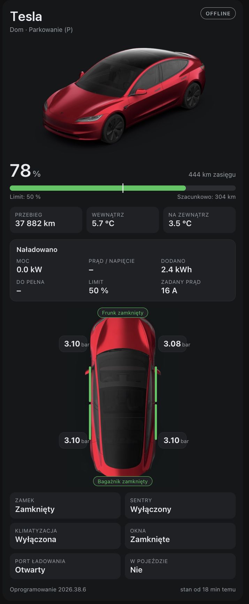

# Tesla card for Home Assistant (TeslaMate + MQTT + button-card)

[Wersja polska](README.pl.md)

A dashboard with a single `custom:button-card` that shows the state of a Tesla based on data published by [TeslaMate](https://github.com/teslamate-org/teslamate) over MQTT. It does not use the Tesla Fleet API or any other external API. It only reads the Home Assistant entities defined in `mqtt_tesla.yaml`.



It shows:

- car state (online, asleep, driving, charging), gear, speed and location (geofence),
- battery level with a charge-limit marker, range, odometer, temperatures,
- a charging panel (power, current, voltage, energy added, time to full),
- a top view of the car: pressure of each tyre, state of the four doors, frunk and trunk,
- lock, Sentry, climate, windows (combined state), charge port, user presence, software version.

> The labels on the card and the entity names in `mqtt_tesla.yaml` are in Polish. To change them, edit the strings in `dashboards/tesla.yaml` (the JavaScript template in the `tc` field) and the `name:` fields in `mqtt_tesla.yaml`. The entity IDs do not depend on the labels.

## Requirements

- Home Assistant with the MQTT integration and a broker (for example the Mosquitto add-on).
- TeslaMate publishing to that broker (`MQTT_HOST`, `MQTT_USERNAME`, `MQTT_PASSWORD` variables).
- [button-card](https://github.com/custom-cards/button-card) installed through HACS (tested with 7.0.1).
- Two pictures of the car. Sample ones are in `www/tesla/`; you can use your own.

## Limitations

- Windows are shown in a single "Okna" (Windows) field. TeslaMate only publishes the combined `windows_open` topic, with no per-window state.
- The data is exactly what TeslaMate publishes. When the car is asleep, values may be stale.
- The files assume `car_id` `1` (topics `teslamate/cars/1/...`). For another car, replace `cars/1` throughout `mqtt_tesla.yaml`.
- The card is fitted to a Model 3 silhouette on a top-view picture with a 443×700 px aspect ratio. With a different picture you will have to move the tyre boxes and door bars (the `.tc-tire` and `.tc-door` rules in `dashboards/tesla.yaml`).
- The layout was checked only automatically (it renders without runtime errors) and on a single installation. It has not been tested on many devices or themes.

## Installation

1. **Install button-card** from HACS (Frontend) and refresh the browser.

2. **Copy the files** to the Home Assistant configuration directory (`/config`):

   ```
   mqtt_tesla.yaml          -> /config/mqtt_tesla.yaml
   dashboards/tesla.yaml    -> /config/dashboards/tesla.yaml
   ```

3. **Copy the car pictures** from `www/tesla/` to `/config/www/tesla/` (URL in Home Assistant: `/local/tesla/...`):

   | File | What it shows | Size |
   |---|---|---|
   | `tesla-iso.jpg` | car from the front at an angle, dark background `#161719` | 800×420 px |
   | `tesla-top.jpg` | car from above, vertical, nose up, same background | 443×700 px |

   The sample pictures show a red Model 3. They are screenshots with the interface elements removed. Before reusing them, check whether you are allowed to, for example for your own private use. Your own pictures need the same proportions and file names. The placement of the tyre boxes and door bars is fitted to the silhouette in `tesla-top.jpg`.

4. **Include the MQTT entities** in `configuration.yaml`.

   If you do not have an `mqtt:` section yet:

   ```yaml
   mqtt: !include mqtt_tesla.yaml
   ```

   If you already have one, append the contents of `mqtt_tesla.yaml` to your own `sensor:` and `binary_sensor:` lists.

5. **Register the dashboard** in `configuration.yaml`:

   ```yaml
   lovelace:
     mode: storage
     dashboards:
       tesla-yaml:
         mode: yaml
         title: Tesla
         icon: mdi:car-electric
         show_in_sidebar: true
         filename: dashboards/tesla.yaml
   ```

   If you already have a `lovelace:` section, only add the entry under `dashboards:`.

6. **Check the configuration and restart Home Assistant.** Use *Developer tools → YAML → Check configuration* or `ha core check`. Changing `configuration.yaml` requires a restart. Later changes to `dashboards/tesla.yaml` only need a page refresh (Cmd/Ctrl+Shift+R).

7. **Open** "Tesla" in the sidebar.

## Entity names

All entities have a fixed `default_entity_id`, so the dashboard finds them regardless of the Home Assistant language. Examples: `sensor.tesla_tesla_poziom_baterii`, `sensor.tesla_tpms_fl`, `binary_sensor.tesla_door_fl`, `binary_sensor.tesla_windows_open`. The full list is in `mqtt_tesla.yaml`.

If you already have entities with the same `unique_id` or names, Home Assistant may add a `_2` suffix. In that case remove the old entities in *Settings → Devices & services → Entities* and restart Home Assistant.

## Security

- Keep MQTT passwords in TeslaMate's `.env` file (permissions `600`) and in the broker's user manager. Do not put them in this repository or in `configuration.yaml`.
- Consider restricting the TeslaMate MQTT account in the broker ACL to write access to `teslamate/#` only.
- TeslaMate (port 4000) and Grafana (port 3000) have no authentication by default. Do not expose them to the internet, and do not bind them to `0.0.0.0` without a reverse proxy that requires a login.
- MQTT on a LAN without TLS sends data in clear text. If the broker is reachable from outside a trusted network, enable TLS.

## Troubleshooting

| Symptom | Cause and action |
|---|---|
| The card shows a template error or is empty | Check the browser console. A button-card JavaScript template must not declare variables named `states`, `entity`, `user`, `hass`, `variables`, `html` or `helpers`. |
| "–" everywhere | The entities are `unknown`. Check in an MQTT explorer whether `teslamate/cars/1/#` has values. |
| Pictures missing | The files must be in `/config/www/tesla/` and have exactly the names shown above. |
| A change in `tesla.yaml` has no effect | Refresh bypassing the cache (Cmd/Ctrl+Shift+R). |

## License

MIT, see [LICENSE](LICENSE).
